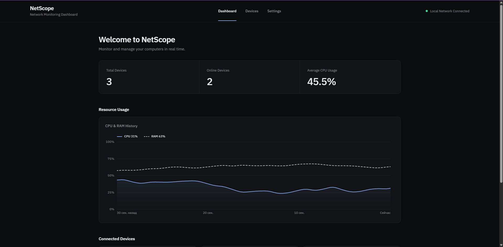
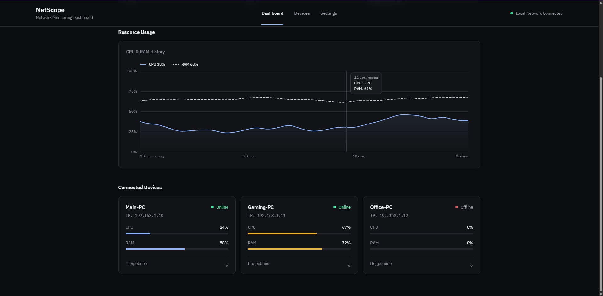
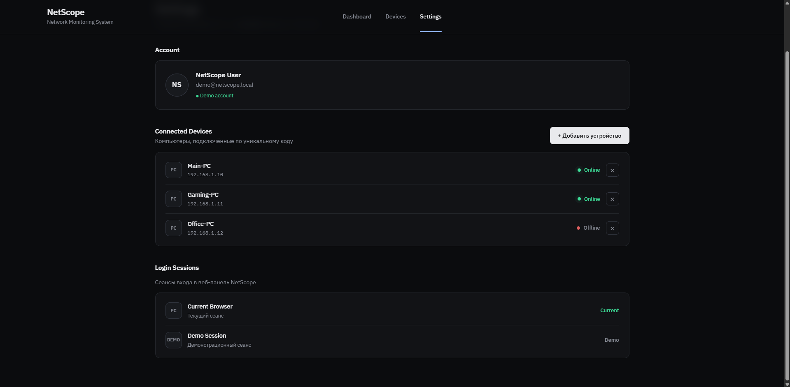

# NetScope

Modern LAN-based PC monitoring system.

## About

NetScope is a system for monitoring
multiple Windows 11 computers over a local network.

## Components

- NetScope Agent
- Netscope Server
- NetScope Dashboard

## Status

DEMO development.

## Run on Windows

Requirements: Windows, CMake 3.20 or newer, and a C++17 compiler.

From the repository root:

```text
cmake -S backend -B backend/build
cmake --build backend/build --config Release
backend/build/Release/netscope_backend.exe
```

If the generator creates a single-configuration build, run `backend/build/netscope_backend.exe` instead.

The server listens on port `8080` on all network interfaces. Open `http://<server-ip>:8080/` from another computer on the same LAN. Allow inbound TCP port `8080` in Windows Firewall when Windows asks, or create an inbound rule for the server executable. Do not expose this demo server directly to the Internet.

The dashboard uses the server URL from the Settings page when it is opened from a different origin. For a normal LAN launch, opening the dashboard through the server URL is sufficient.

## Screenshots

### Dashboard


### Devices


### Settings
